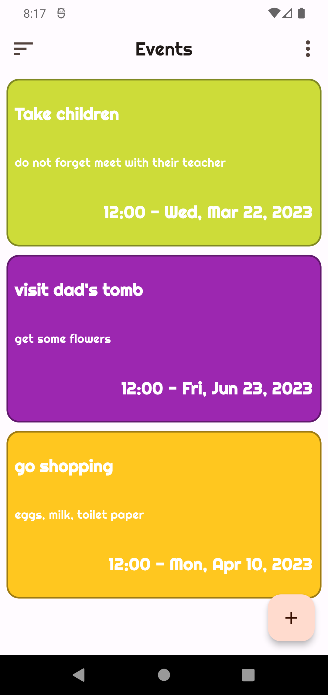
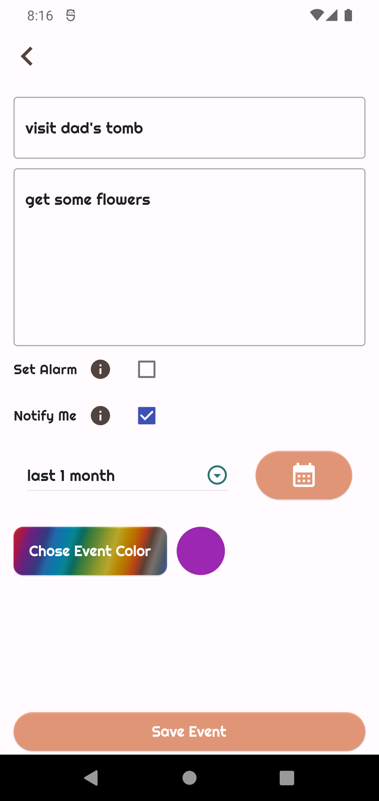
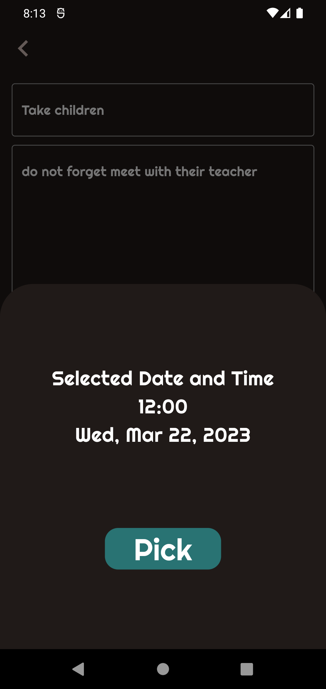
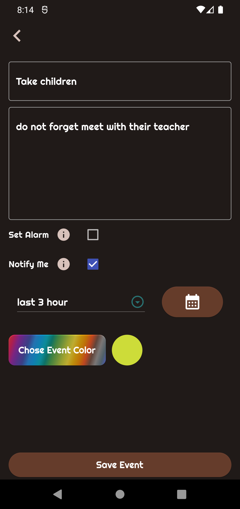
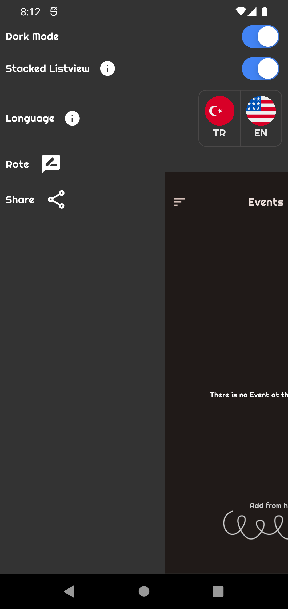
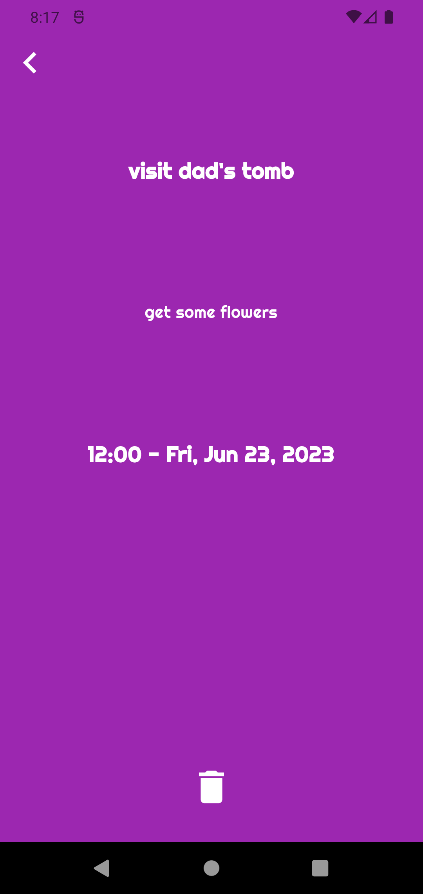
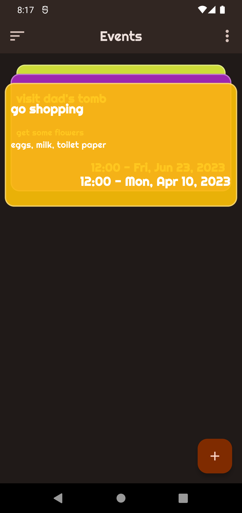
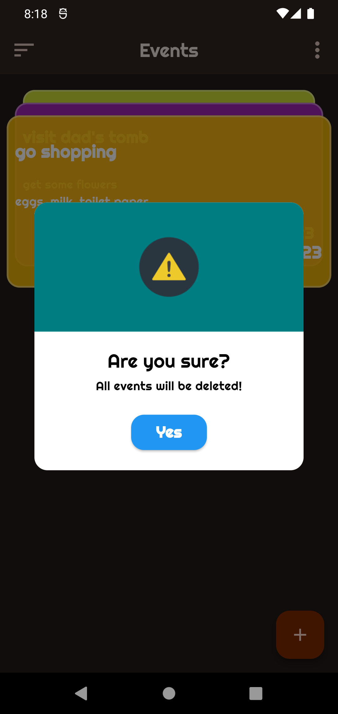
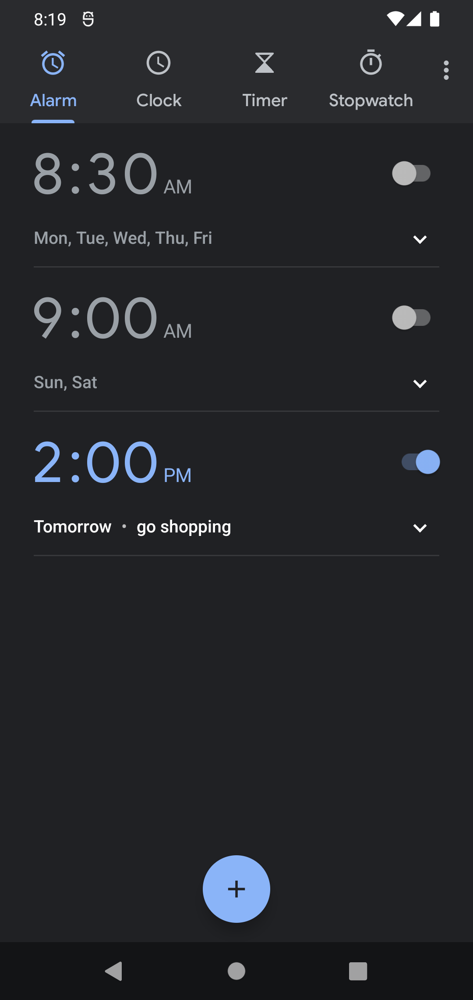
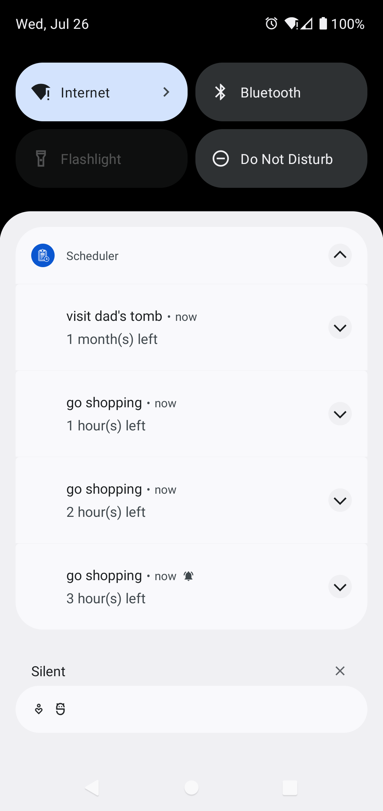

# scheduler

### An offline event-tracking mobile app.
### https://play.google.com/store/apps/details?id=com.resoftware.scheduler

## Architecture : Stores (ChangeNotifier) + screens
## State-Management : Provider, Default(setState)
## Design : Material-3
## Localization : Easy Localization
## Routing : Default (Navigator)
## Caching : Hive
## Notification : flutter_local_notifications
## Illustrations : Undraw

😎---ScreenShots & Media---😎

  |    |
  |    |
  |    |
  |    |
  |   |

👇---Youtube Video---👇

[](http://www.youtube.com/watch?v=WpBWiJPj3cw)

## Notifications

Reminders are scheduled locally with `flutter_local_notifications`
(`lib/services/notification_service.dart`). Each event gets a notification at its
start time plus an optional advance reminder (`lib/models/reminder_period.dart`).
All pending reminders are rebuilt on every launch and language change.

Android needs the scheduled-notification receivers in `AndroidManifest.xml`; their
absence was why reminders never arrived in 1.0.5 and earlier.

## Tests

```bash
flutter test                         # unit + platform-config tests
./scripts/test_notifications.sh      # on a booted emulator/device: a real reminder must be delivered
```

## Privacy and support

[Privacy policy](PRIVACY.md) · [Support](SUPPORT.md)

## Store assets

See [showcase/README.md](showcase/README.md).
